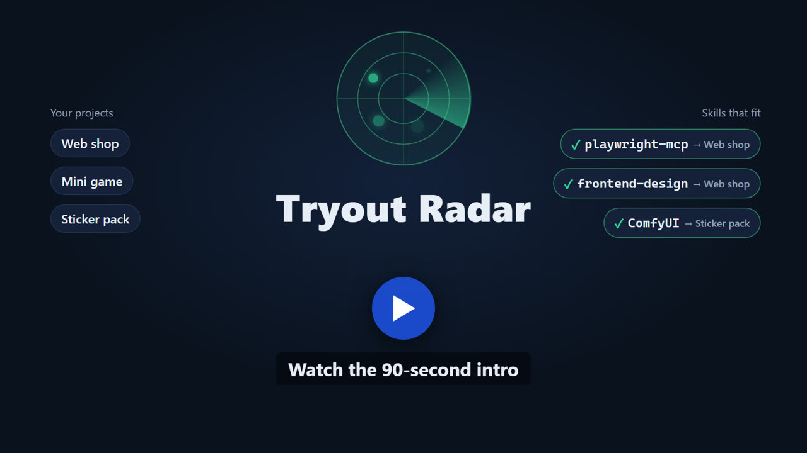

# Tryout Radar

**Find new AI tools that fit your projects, try them in a sandbox branch, get a report.**

[中文说明](README.zh-CN.md) · [Introduction / 介绍](docs/INTRO.md)

[](https://github.com/alex7-1/tryout-radar/releases/download/v0.3.0/tryout-radar-intro-en.mp4)

*The 90-second intro video. Also in [Chinese with English subtitles](https://github.com/alex7-1/tryout-radar/releases/download/v0.3.0/tryout-radar-intro-zh.mp4).*

Every day a coding agent (the *scout*) reads GitHub, X and the web for new skills, MCP servers, agent tricks and generation tools, keeps only what would help *your* projects, and says for each one which project it helps, where, and how much effort it takes. You read the digest on your phone. When something looks good you press **Try it in a project**; that night a second agent (the *trial runner*) installs it in a sandbox branch of that project, runs it with the project's own tests, and sends you a report: adopt, don't use, or your call.

```
GitHub · X · web ──► scout (daily) ──► digest site ──► you: "Try it in a project"
                                          ▲                         │
                                          │                         ▼
                     report + verdict ◄── trial runner (nightly, sandbox branch)
```

Most AI-news digests stop at "here is what's new". Tryout Radar closes the loop to "here is what happened when we tried it in your code".

> **Status: v0.3, early.** Extracted from a personal setup that runs daily with Claude Code desktop scheduled tasks on Windows and a small Linux server. This packaged version passes its unit tests on Python 3.12 and 3.13; long unattended runs of the packaged version are still to come. Read [SECURITY.md](SECURITY.md) before letting it run third-party code.

It runs with a coding agent (Claude Code, Codex, …) or, for the daily scout, with **any chat model** through an OpenAI-compatible API: see [Run with any model](#run-with-any-model-api-mode).

## Install (Claude Code)

At the prompt of a Claude Code terminal session:

```
/plugin install tryout-radar --marketplace alex7-1/tryout-radar
```

Answer `y` to add the marketplace, then press Enter for the user scope. Then say **"set up Tryout Radar"** (or type `/radar` and press **Set up now**): Claude proposes your projects from your recent sessions, asks where to send the daily summary, and schedules the two jobs. Needs Python 3.11+. The plugin also works in sessions the Claude desktop app runs once it is installed from a terminal.

Not on Claude Code? See [Without the plugin](#without-the-plugin).

## The panel: `/radar`

| Tab | What you do there |
| --- | --- |
| Today | Read the digest; **Try in &lt;project&gt;** queues a trial; mark items *Want* / *Not relevant*; stop following a newly spotted direction |
| Projects | Follow or stop following any project (from config, discovered, or yours); **Add a project** by hand |
| Topics | See what is watched and for which projects; **Add a topic** with keywords and tie it to projects; pause your topics |
| Trials | Queued, running and finished trials; open a report |

Buttons at the bottom start the scout or the trial runner in the current session. Everything the panel changes lives in plain JSON files under `~/.tryout-radar/data/`, the same files the scheduled jobs read.

## What you get

- **A digest scored against your projects.** You describe each project once (in the panel, or in `config.toml`): what it is, its pain points, its interests. Every item gets a fit score per project and a concrete "use it for …".
- **You decide what is watched.** Add your own projects and topics, tie a topic to the projects it is for, switch anything off and on again. A project you switch off is never brought back by discovery.
- **It notices new projects.** Before each digest the scout looks at what you worked on lately in Claude Code and Codex (session titles and folders only, never message content). When you keep working on something new, say a sticker pack for your shop, it adds that as a project and starts finding tools for it the same day. One click on the site stops following it.
- **It learns from your marks.** Mark items *want to try / using it / not relevant*. The scout drops similar noise and follows up on what you wanted.
- **One-click trials.** A queued request becomes a git worktree on branch `tryout/<id>`, an install, a test run, and a report with evidence (commands, test results, diff stat). Nothing is merged or pushed; adopting is a separate step you start.
- **Project rules first.** The trial runner reads each project's `AGENTS.md` / `CLAUDE.md` before touching it, and stops to ask when a step would need money, keys, admin rights, production access or sending data out.
- **Any model for the scout.** OpenAI, DeepSeek, Qwen, Kimi, GLM, Gemini, Claude, OpenRouter or a local model in Ollama: code does the fixed steps, the model only judges, and its answers are checked before they reach the digest.
- **Notifications** to WeCom (group robot or app), Feishu, Telegram, Slack or Discord.
- **No dependencies.** Python 3.11+ standard library only. A static site plus a tiny server for the buttons.

## How it fits together

| Part | What it is |
| --- | --- |
| `skills/tryout-radar/` | The Claude Code skill: setup, running the jobs, changing projects and topics |
| `hooks/register.tsx` | The `/radar` panel (Claude Code plugin hooks module) |
| `prompts/scout.md` | Instructions for the daily scout agent |
| `prompts/trial.md` | Instructions for the nightly trial-runner agent |
| `config.toml` | Your settings, sources, limits and notification channels; projects and topics can live here too (`radar init` makes one in `~/.tryout-radar/`; every option is in `config.example.toml`) |
| `tryout_radar/`, `radar.py` | Command line the agents call: `publish`, `history`, `feedback`, `notify`, `queue …`, `project …`, `topic …`, `discover`, `serve`; and `scout` / `model check` for API mode |
| `tryout_radar/collect.py`, `scout.py`, `llm.py` | API mode: the sources, the checks around the model's answers, the OpenAI-compatible client |
| `schema/report.schema.json` | The JSON the scout writes each day ([example](examples/report.example.json)) |
| `deploy/` | systemd unit, nginx snippet, scheduling guide |

With an agent, the agent does the judgement (searching, reading, deciding, writing) and the Python code only stores, renders, serves and sends. In API mode the code also collects and checks, and the model only judges and writes.

## Without the plugin

Any coding agent that can read files, fetch pages, search the web and run shell commands can run the two prompts.

```bash
git clone https://github.com/alex7-1/tryout-radar && cd tryout-radar
cp config.example.toml config.toml        # describe your projects and topics, pick channels
python -m tryout_radar publish examples/report.example.json   # build the site from sample data
python -m tryout_radar serve              # open http://127.0.0.1:8091/<secret_path>/
```

Then schedule the two agents (see [deploy/scheduling.md](deploy/scheduling.md)). With Claude Code desktop that is two scheduled tasks in this folder:

```
Read prompts/scout.md in this folder completely and follow it exactly.      (daily, 12:00)
Read prompts/trial.md in this folder completely and follow it exactly.      (nightly, 22:00)
```

To read the digest on your phone, run `serve` on a machine you can reach over HTTPS (see `deploy/nginx.example.conf`), set `site.base_url`, and configure a notification channel. The site works without the server too (plain static files, e.g. on any static host), but then the buttons are hidden.

## Run with any model (API mode)

No coding agent needed for the daily digest: `python -m tryout_radar scout` runs the whole scout with any chat model behind an OpenAI-compatible API, which nearly every provider and local runner offers (OpenAI, DeepSeek, Qwen, Kimi, GLM, Gemini, Claude, OpenRouter, Ollama, LM Studio, vLLM).

- **Code does the fixed steps:** GitHub search and trending, the release lists, changelogs, feeds and pages each topic watches, Hacker News, an optional search service; de-duplication against earlier digests and your marks; stars, links and dates; spotting new projects' folders; publishing and notifying.
- **The model only judges and writes:** which candidates to keep, the fit and "use it for …" per project, the headline, the three picks, tips from the changelogs.
- **Its answers are checked:** it can only keep candidates the code found and use your project and topic keys; texts are trimmed; titles, links and stars always come from the sources. A model that returns broken JSON gets one retry; if it still fails nothing is published.

```toml
[model]
base_url = "https://api.deepseek.com/v1"     # or http://localhost:11434/v1 for Ollama, etc.
model = "deepseek-chat"
api_key_env = "DEEPSEEK_API_KEY"             # the environment variable that holds the key
```

```bash
python -m tryout_radar model check           # one short request: is the model reachable?
python -m tryout_radar scout --dry-run       # a full run that changes nothing and prints the report
python -m tryout_radar scout                 # publish and notify; schedule this once a day
```

Compared with an agent running `prompts/scout.md`: the sources are fixed rather than browsed freely, X is read only through a search service (`[sources.search]`), and the quality of the scoring follows the model. The trial runner still needs a coding agent. Set `GITHUB_TOKEN` (a token without scopes is enough) to search more per run. What goes to your model provider: your project and topic descriptions, the candidates' public text, and, when discovery is on, recent session titles and folder names (your home folder shown as `~`).

## Commands

```
python -m tryout_radar publish REPORT.json|-      save today's digest, rebuild the site
python -m tryout_radar history [--days N]         recently reported items (for de-duplication)
python -m tryout_radar feedback                   your marks
python -m tryout_radar notify MESSAGE.md|-        send a message to every channel
python -m tryout_radar queue list                 queued trial requests
python -m tryout_radar queue start|requeue TID
python -m tryout_radar queue finish TID --result RESULT.json|-
python -m tryout_radar discover                   recent agent work (titles + folders) and known projects
python -m tryout_radar project add PROJECT.json|- [--manual] / follow KEY / ignore KEY / list
python -m tryout_radar topic add TOPIC.json|- / pause KEY / resume KEY / link KEY --projects a,b / list
python -m tryout_radar init | rebuild | serve
python -m tryout_radar scout [--dry-run | --collect-only] [--no-notify] [--out FILE]   API mode, any model
python -m tryout_radar model check                check the [model] settings
```

`-` reads from standard input, so the commands work over `ssh` when the site runs on a server and your projects on your PC. With the plugin, `python <plugin folder>/radar.py <command>` does the same with settings in `~/.tryout-radar/`.

Tests: `python -m unittest discover -s tests` (Python), `claude plugin test .` (the panel).

## Related projects

Good work exists on each half of this loop:

- Digests: [frankzch/ai-news-skill](https://github.com/frankzch/ai-news-skill), [wyh0626/ai-news-agent](https://github.com/wyh0626/ai-news-agent), and trackers such as [linny006/awesome-agent-skills](https://github.com/linny006/awesome-agent-skills).
- Testing skills: [Skill_evaluation_sandbox](https://github.com/Vismay2402/Skill_evaluation_sandbox) and similar skill evaluation runners.

Tryout Radar's focus is the connection: scoring against your own projects, and trying a find inside your own repository with your own tests.

## Roadmap

- Built-in container isolation for trials
- More channels (email), RSS output
- Optional GitHub Actions workflow for the scout

## License

[MIT](LICENSE)
