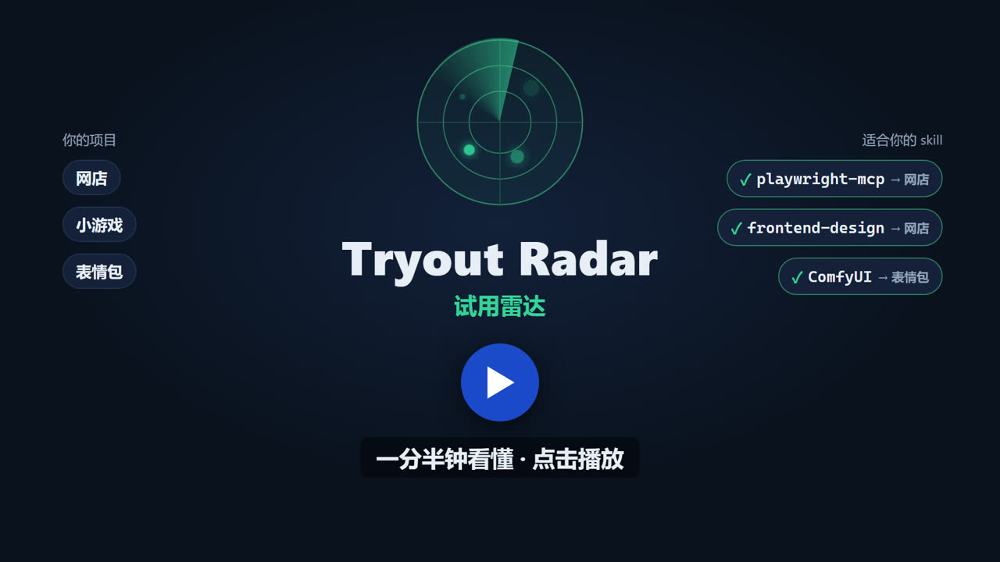

# Tryout Radar

**找出适合你项目的新 AI 工具，在单独分支里试一遍，给你一份报告。**

[English](README.md) · [介绍 / Introduction](docs/INTRO.md)

[](https://github.com/alex7-1/tryout-radar/releases/download/v0.3.0/tryout-radar-intro-zh.mp4)

*一分半钟的介绍视频（中文配音，中英字幕）。也有 [英文配音版](https://github.com/alex7-1/tryout-radar/releases/download/v0.3.0/tryout-radar-intro-en.mp4)。*

每天，一个编程 agent（*侦察员*）在 GitHub、X 和网上找新出的 skill、MCP、agent 用法和生成工具，只留下对*你的*项目真正有用的，并写清楚每条对哪个项目有用、用在哪里、上手要多久。你在手机上看日报，看到好用的就点 **交给项目试**；当晚另一个 agent（*试用员*）在那个项目的单独分支里装上、跑项目自己的测试，然后把报告发给你：建议采纳、不建议用，还是要你决定。

```
GitHub · X · 网页 ──► 侦察员（每天）──► 日报网页 ──► 你：「交给项目试」
                                          ▲                     │
                                          │                     ▼
                        报告和结论 ◄── 试用员（每晚，单独分支）
```

大多数 AI 日报停在“今天出了什么”。Tryout Radar 往前多走一步：“放进你的代码里试了，结果是这样”。

> **状态：v0.3，早期版本。** 从一套每天在用的个人配置里整理出来（Windows 上的 Claude Code 桌面版定时任务 + 一台小 Linux 服务器）。打包版在 Python 3.12 和 3.13 上通过了单元测试，长期无人值守运行还没验证。让它运行第三方代码之前，先读 [SECURITY.md](SECURITY.md)。

可以用编程 agent（Claude Code、Codex 等）来跑；每天的侦察员也可以通过 OpenAI 兼容接口用**任何聊天模型**来跑，见[用任何模型运行](#用任何模型运行api-模式)。

## 安装（Claude Code）

在 Claude Code 终端会话的输入框里输入：

```
/plugin install tryout-radar --marketplace alex7-1/tryout-radar
```

问是否添加插件市场时回 `y`，然后回车选“用户范围”。装好后说一句 **“设置 Tryout Radar”**（或者输入 `/radar`，点「现在设置」）：Claude 会根据你最近的会话列出你的项目让你确认，问摘要发到哪里，再把两个定时任务建好。需要 Python 3.11 或更新。在终端装好以后，Claude 桌面版里的会话也能用。

不用 Claude Code？见[不装插件也能用](#不装插件也能用)。

## 面板：`/radar`

| 页 | 能做什么 |
| --- | --- |
| 今天 | 看日报；点「交给〈项目〉」排队试用；标「想试 / 不相关」；对新发现的方向点「不用关注」 |
| 项目 | 任何项目都能「关注 / 不关注」（配置里写的、自动发现的、你自己加的都行）；「加项目」手动添加 |
| 主题 | 看在关注哪些主题、各自对应哪些项目；「加主题」填关键词并点选对应的项目；停用你加的主题 |
| 试用 | 排队中、试用中、已完成的试用；点开看报告 |

底部按钮可以在当前会话里立刻跑侦察员或试用员。面板改的东西都存在 `~/.tryout-radar/data/` 下的普通 JSON 文件里，定时任务读的就是这些文件。

## 能做什么

- **按你的项目打分的日报。** 每个项目写一次（在面板里，或者 `config.toml` 里）：是什么、痛点、关注什么。每条都有对每个项目的契合度和具体的“可以用来……”。
- **关注什么你说了算。** 自己加项目、加主题，把主题对应到具体项目，任何一项都能关掉再打开。你关掉的项目，自动发现不会再把它加回来。
- **会发现你的新项目。** 每次出日报前，侦察员先看看你最近在 Claude Code 和 Codex 里做什么（只看会话标题和文件夹，不读对话内容）。你持续在做一件新事，比如给网店做表情包，它就把这件事加成一个项目，当天开始为它找工具；网页上点一下就能不再关注。
- **会根据你的标记调整。** 给条目标「想试 / 用上了 / 不相关」，侦察员会少推同类的噪音，并跟进你想试的东西。
- **一键试用。** 排队的请求会变成分支 `tryout/<编号>` 上的 git worktree：安装、跑测试、出带证据的报告（命令、测试结果、改动统计）。不合并、不推送；采纳是你另外发起的一步。
- **项目规矩优先。** 试用员动手前先读项目的 `AGENTS.md` / `CLAUDE.md`；遇到要花钱、要钥匙、要管理员权限、要碰线上、要往外发数据的步骤就停下来问你。
- **侦察员可以用任何模型。** OpenAI、DeepSeek、通义千问、Kimi、智谱、Gemini、Claude、OpenRouter，或者 Ollama 里的本地模型：固定步骤由代码做，模型只负责判断，它的回答进日报前会逐项检查。
- **推送**到企业微信（群机器人或自建应用）、飞书、Telegram、Slack 或 Discord。
- **零依赖。** 只用 Python 3.11+ 标准库：静态网页 + 一个给按钮用的小服务。

## 组成

| 部分 | 是什么 |
| --- | --- |
| `skills/tryout-radar/` | Claude Code skill：设置、运行两个任务、修改项目和主题 |
| `hooks/register.tsx` | `/radar` 面板（Claude Code 插件的 hooks 模块） |
| `prompts/scout.md` | 每天的侦察员指令 |
| `prompts/trial.md` | 每晚的试用员指令 |
| `config.toml` | 设置、信息源、限制和推送渠道；项目和主题也可以写在这里（`radar init` 会在 `~/.tryout-radar/` 建一个；全部选项见 `config.example.toml`） |
| `tryout_radar/`、`radar.py` | agent 调用的命令行：`publish`、`history`、`feedback`、`notify`、`queue …`、`project …`、`topic …`、`discover`、`serve`；API 模式用的 `scout` / `model check` |
| `tryout_radar/collect.py`、`scout.py`、`llm.py` | API 模式：信息源、对模型回答的检查、OpenAI 兼容接口客户端 |
| `schema/report.schema.json` | 侦察员每天写的 JSON 格式（[示例](examples/report.example.json)） |
| `deploy/` | systemd 服务、nginx 配置片段、定时运行说明 |

用 agent 时，判断（搜索、阅读、取舍、写报告）交给 agent，Python 代码只负责存储、生成网页、提供按钮接口和发消息。API 模式下，搜集和检查也由代码做，模型只负责判断和写字。

## 不装插件也能用

任何能读文件、打开网页、搜索网页、运行命令的编程 agent 都能跑这两份指令。

```bash
git clone https://github.com/alex7-1/tryout-radar && cd tryout-radar
cp config.example.toml config.toml        # 写你的项目和关注方向，选推送渠道
python -m tryout_radar publish examples/report.example.json   # 用示例数据生成网页
python -m tryout_radar serve              # 打开 http://127.0.0.1:8091/<secret_path>/
```

然后把两个 agent 定时跑起来（见 [deploy/scheduling.md](deploy/scheduling.md)）。用 Claude Code 桌面版就是在这个文件夹建两个定时任务：

```
Read prompts/scout.md in this folder completely and follow it exactly.      （每天 12:00）
Read prompts/trial.md in this folder completely and follow it exactly.      （每晚 22:00）
```

想在手机上看：在一台能通过 HTTPS 访问的机器上运行 `serve`（见 `deploy/nginx.example.conf`），设置 `site.base_url`，再配一个推送渠道。不开服务也能用（网页就是静态文件，可以放任何静态托管），只是按钮会隐藏。

`config.toml` 里把 `language` 设为 `"zh-CN"`，日报、网页和报告就都是中文。

## 用任何模型运行（API 模式）

每天的日报可以不用编程 agent：`python -m tryout_radar scout` 通过 OpenAI 兼容接口，用任何聊天模型跑完整个侦察员流程。几乎所有厂商和本地运行工具都提供这种接口：OpenAI、DeepSeek、通义千问、Kimi、智谱、Gemini、Claude、OpenRouter、Ollama、LM Studio、vLLM。

- **固定步骤由代码做：** GitHub 搜索和 trending、每个主题关注的 release 列表、更新日志、RSS 和网页、Hacker News、可选的搜索服务；按以前的日报和你的标记去重；star 数、链接和日期；识别新项目所在的文件夹；发布和推送。
- **模型只负责判断和写字：** 留下哪些候选、对每个项目的契合度和“可以用来……”、标题、前三名、从更新日志里提炼的用法。
- **模型的回答会被检查：** 它只能从代码找到的候选里挑，只能用你已有的项目和主题；文字会被截短；标题、链接和 star 数始终来自信息源。回答不是合法 JSON 时会重试一次，还不行就不发布。

```toml
[model]
base_url = "https://api.deepseek.com/v1"     # Ollama 用 http://localhost:11434/v1，其他厂商同理
model = "deepseek-chat"
api_key_env = "DEEPSEEK_API_KEY"             # 存放 key 的环境变量名
```

```bash
python -m tryout_radar model check           # 发一个很短的请求，看模型能不能连上
python -m tryout_radar scout --dry-run       # 完整跑一遍，但什么都不改，只打印日报
python -m tryout_radar scout                 # 发布并推送；每天定时跑这一条
```

和用 agent 跑 `prompts/scout.md` 相比：信息源是固定的，不会自由浏览；X 只能通过搜索服务读（`[sources.search]`）；打分质量取决于模型。试用员仍然需要编程 agent。设置 `GITHUB_TOKEN`（不需要任何权限的 token 就行）可以每次多搜一些。会发给模型厂商的内容：你的项目和主题描述、候选条目的公开文字；开启自动发现时，还有最近的会话标题和文件夹名（你的用户目录显示为 `~`）。

## 命令

```
python -m tryout_radar publish 日报.json|-        保存今天的日报，重建网页
python -m tryout_radar history [--days N]         最近报过的条目（去重用）
python -m tryout_radar feedback                   你的标记
python -m tryout_radar notify 消息.md|-           发给所有推送渠道
python -m tryout_radar queue list                 排队中的试用请求
python -m tryout_radar queue start|requeue 编号
python -m tryout_radar queue finish 编号 --result 结果.json|-
python -m tryout_radar discover                   最近在 agent 里做了什么（标题和文件夹）和已知项目
python -m tryout_radar project add 项目.json|- [--manual] / follow 名称 / ignore 名称 / list
python -m tryout_radar topic add 主题.json|- / pause 名称 / resume 名称 / link 名称 --projects a,b / list
python -m tryout_radar init
python -m tryout_radar rebuild | serve
python -m tryout_radar scout [--dry-run | --collect-only] [--no-notify] [--out 文件]   API 模式，任何模型
python -m tryout_radar model check                检查 [model] 设置
```

`-` 表示从标准输入读，所以网页在服务器、项目在自己电脑上时，可以通过 `ssh` 调用这些命令。

装了插件时，`python <插件文件夹>/radar.py <命令>` 效果一样，设置放在 `~/.tryout-radar/`。

运行测试：`python -m unittest discover -s tests`（Python 部分），`claude plugin test .`（面板）。

## 相关项目

这个闭环的两半都有不错的项目：

- 日报：[frankzch/ai-news-skill](https://github.com/frankzch/ai-news-skill)、[wyh0626/ai-news-agent](https://github.com/wyh0626/ai-news-agent)，以及 [linny006/awesome-agent-skills](https://github.com/linny006/awesome-agent-skills) 这类追踪清单。
- 测试 skill：[Skill_evaluation_sandbox](https://github.com/Vismay2402/Skill_evaluation_sandbox) 等 skill 评测工具。

Tryout Radar 做的是把两半连起来：按你自己的项目打分，并在你自己的仓库里、用你自己的测试去试。

## 计划

- 内置容器隔离的试用
- 更多渠道（邮件）、RSS 输出
- 可选的 GitHub Actions 侦察员工作流

## 许可证

[MIT](LICENSE)
